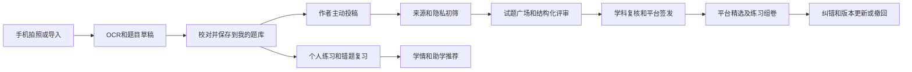

# 知序全面审核与下一版优化方案

审核日期 2026-11-21。主应用范围为 `study-platform` 当前工作区，包括尚未提交的整合代码。`OpenMAIC`、`oh-my-paper`、`xl-frontend` 和其他相邻目录用于核对来源。试题集按实际发布指针核对。本方案给出实施边界、顺序和验收标准。

**题库版本决策。** r5 已全量替换 r3，是唯一在用的高考真题快照，现有 r5 数据库继续只读使用。r3 的旧学习记录列入后续应用库清理，不做跨版迁移。从 r5 起，用户收录的题目保存当时版本，后续题库更新时可在「我的题库」继续查看。下文为方案安排，清理和版本功能均未执行。

## 1. 下一版的产品主线

把知序的首页和导航围绕三个用户动作组织起来。**拍到一道题就能存到「我的题库」，遇到错题就能排进复习，愿意共享时再单独投稿。** 匿名访客能阅读通过公开初筛的题目、答案和解析。学科评审把关内容，平台编辑签发后，合格版本进入「平台精选」，与既有高考试题一起供用户检索、练习和组卷。界面同时标注「高考真题」和「平台精选」的来源，避免用户误解为考试机构发布。

原始照片及导入工作单只服务于私人校对。投稿建立一份单独、可审核的内容版本，编辑私人原题不会改变别人正在浏览的版本。第一阶段把「拍照 → 保存 → 再打开 → 练习 → 复习」做成真正可用的路径。后续阶段依次开放投稿、广场和官方发布。

## 2. 现有模块怎么用

| 模块 | 当前已具备的能力 | 下一版用途 |
| --- | --- | --- |
| 练习、知识点与高考真题库 | r5 只读题库，可查题、按知识点练习、控制答案解锁、提交作答、记录错题和内容纠错 | 保留作答门禁和题组语义。增加平台精选来源筛选，通过统一题目引用读取当前题和从 r5 起保存的个人版本。[练习与错题实现](../app/practice.py) |
| 拍题上传 | 图片选择和摄像建议、旋转裁剪、识别校对、相似题、AI 讲解及加入上传错题。流程使用 `ai_uploads`，结束时主要落在讲解及上传错题 | 原入口升级为「拍题入库」，把保存到我的题库作为校对后的主动作，讲解与复习作为保存后的动作。[拍题入口](../web/js/pages/upload.js#L240) · [上传错题](../web/js/pages/upload.js#L505) |
| 我的题库、试卷工坊 | `pl_questions` 支持按用户隔离的增删改查和拥有者核验。工坊支持页级 OCR、生成草稿、视觉识别及双模型核验、批量转入个人库，已有组卷快照、整卷练习、答题卡和导出 | 复用一种题目表单和内容规范。单题拍摄走简化校对，多页图片与 PDF 进入批量工作台。组卷与导出继续冻结实际使用版本。[个人题库](../app/paperlab/bank.py#L84) · [导入端点](../app/paperlab/digitize.py#L1020) · [整卷快照](../app/paperlab/papers.py#L122) |
| OCR、模型与任务中心 | RapidOCR 提供本地识别。已有视觉模型和异步任务、取消、重试、进度与核验。Surya 转 LaTeX 适配已预置 | OCR 先给草稿，复杂公式和图表再按需走视觉识别或人工修订。统一记录来源、耗时、模型与失败原因。优先保证轻量拍题任务的响应，课堂渲染和视频使用单独并发额度。[OCR](../app/ai/ocr.py#L625) · [任务引擎](../app/ai/jobs.py#L447) · [Surya 说明](../README.md#L54) |
| 题目社区与管理后台 | 现有社区能力用于登录后分享符合条件的既有题目 AI 解析，管理员可精选。已有题库纠错、隔离、处理状态和审计链 | 复用后台事件记录、纠错工作台交互和隔离能力。新增投稿、指定版本的结构化评审和发布记录。个人核验、双模型一致和社区解析精选分别保留各自语义。[社区分享](../app/ai/jobs.py#L677) · [内容问题状态](../app/practice.py#L2991) |
| 小纸助手、学情、笔记、Anki | 助手、学情、笔记、错题导出和任务中心已经运行。学情已分别聚合常规作答和整卷练习等信息 | 小纸从当前题或复习会话发起讲解，答案显示受授权和练习态控制。学情用去重后的作答、错因和知识点推荐下一步。Anki 与笔记作为输出，保留站内题目链接和版本。[学情口径](../app/insight.py#L3) · [Anki 导出](../app/anki_export.py) |
| AI 课堂、物理演示、志愿、专注 | 课堂、画布、媒体、物理演示和志愿查询已有产品入口。专注计时和每日一句属于辅助功能 | 题目或错题组可发起课堂/物理演示，允许添加该知识点到复习。学习导航将志愿放进独立区，继续显示省年数据覆盖和缺口。专注、每日一句保留在辅助位置。[应用路由](../app/main.py#L661) · [录取数据缺失说明](../数据缺失声明.md) |

## 3. 上线前需要处理的发现

| 优先级 | 当前证据及影响 | 处理和验收 |
| --- | --- | --- |
| P0 · r3 替换后的旧学习记录待清理 | `CURRENT` 指向 `bank-20261121-r5`。此前只读核对显示两版 `qid` 与 `source_question_id` 均无交集。本地应用库有 1 条作答、1 条错题、1 条掌握度记录只在 r3 能解析，实施时需重新盘点。[题库指针](../../高考题库_按学科/releases/CURRENT) · [错题查询](../app/practice.py#L2788) | 后续仅从应用库清理明确属于 r3 的学习记录，保留 r5 和私人内容。r5 作为统一基线，个人题目留版机制从 r5 开始。 |
| P0 · r5 的列类型与练习代码不一致 | 发布生成器将题目和题组列统一建为 `TEXT`，题目 ID 缺少主键约束。`objective='0'` 在 Python 真值判断中为真。r5 有 184 条可练状态的非客观题同时含选项，需验证其输入校验。按文本题序排序和按数值排序差异涉及 1,174 套卷。PostgreSQL 同步复用源类型，年份查询需真实 PostgreSQL 验证。[发布生成器](../../高考题库_按学科/tools/ingest/build_release.py#L81) · [作答判型](../app/practice.py#L2320) · [组卷题序](../app/practice.py#L1771) · [镜像导入](../app/db.py#L478) | 兼容放在应用读取和 PostgreSQL 导入层，显式转型并回归输入类型、题序、年份区间及题组。新增的类型、主键、索引和完整性校验放到后续发布包的生成流程，当前 r5 文件继续只读。 |
| P0 · 验收脚本出现成功假象 | `ci_accept.ps1` 的 JS 检查块直接 `exit 0`，本轮从该阶段成功退出，未到后面的 pytest 与 UI 阶段。r5 专项独立运行得到 80 通过、2 跳过、5 个 fixture 初始化错误，错误来自共用 fixture 依赖 r3 的固定 `qid`。[验收脚本](../scripts/ci_accept.ps1#L45) · [快照 fixture](../tests/test_bank_content.py#L212) | 将 r5 设为验收基线，依赖旧固定题 ID 的通用用例改用自含小型 fixture。修脚本把阶段结果传给汇总函数，校验失败或漏跑必须返回非零。发布按 `build_id`、`bank_version` 双标识留痕。 |
| P0 · 公网模式的部署默认值需要显式收紧 | Compose 默认以本地模式启动，Redis 提供示例回退值，应用默认信任任意转发来源。当前 demo 的本地模式允许首注册用户成为管理员。公网部署在保持服务私网隔离的基础上，应保证这些本地默认值无法作为公网配置生效。[生产配置](../deploy/docker-compose.yml#L8) · [注册策略](../app/auth.py#L103) · [注册与管理员初始化](../app/auth.py#L200) | 用公网启动配置与发布校验强制管理员初始化分离、非示例密钥、可信反代和 API 权限。普通上传账户无法配置开放的出站请求目的地。隔离环境验证 HTTPS 注册登录、Worker 就绪、异地恢复和两账号隔离。 |
| P0 · 题图需要独立的所有权校验 | 个人题目内容可保存客户端提供的图片引用。图接口校验了题主，随后直接读取存储引用。附件本身缺少明确的所有者和用途关联。[内容规范](../app/paperlab/schema.py#L289) · [题图处理](../app/paperlab/bank.py#L355) · [存储适配](../app/storage.py#L110) | 建服务端签发的资产 ID，读图同时校验资产归属、题目版本及可见性。旧引用经确认归属后迁移。匿名仅能读独立发布的衍生图。加入两个真实角色和两个用户的回归覆盖。 |
| P0 · 上传资源和备份覆盖不完整 | 部分导入及扫描端点先整读再检查大小。现有应用备份的本地文件白名单未覆盖工坊及课堂目录，宣称备份成功无法证明新增资产可恢复。[扫描](../app/paperlab/scan.py#L1403) · [导入](../app/paperlab/bank_io.py#L543) · [备份范围](../app/ops.py#L47) | 在反代、API、页数/像素与异步资源预算同时限额。备份包含数据、资产、密钥与题库版本，SQLite 和 PostgreSQL/S3 分别演练恢复，验证图片、历史作答和发布状态齐全。 |
| P0 · 整卷续做可能读取修改后的试卷 | 创建时记录了 `paper_version`，实际继续练习和判分时仍按 `paper_id` 读取当前题目。草稿卷允许改题和顺序。[试卷题读取](../app/paperlab/practice.py#L582) · [创建作答](../app/paperlab/practice.py#L632) · [编辑替换试题](../app/paperlab/papers.py#L868) | 练习开始时冻结试卷版本及逐题资源引用。覆盖作答后修改题、移除题和重排的场景。旧版本缺失时提示历史题面不可追溯。 |
| P1 · 对象存储和默认媒体镜像存在运行缺口 | 数处工坊及课堂写入调用未持久化 `save_file` 的返回引用，部分导出只读本地。在 S3 模式存在写入和读取不一致。Docker 装了 FFmpeg，默认依赖没有 Playwright 与浏览器，而 PDF、课程视频需要浏览器渲染。[工坊存储](../app/paperlab/digitize.py#L871) · [工坊导出](../app/paperlab/exporters.py#L199) · [镜像](../deploy/Dockerfile#L9) · [PDF 能力探针](../app/ai/render.py#L44) | 保存实际引用，按本地/S3 各跑上传、校对、导出、恢复。媒体能力用明确的 Worker 配置与就绪探针启用，部署用镜像内任务产物验收。 |
| P1 · 拍题、个人题、作答和复习有数据断点 | 拍题进入 `ai_uploads`，工坊题进入 `pl_questions`。整卷已有 `bank:qid` 与 `app:ID`，但错题联动当前只处理原高考题来源。上传错题和普通错题查询也分开。[拍题上传](../app/ai/upload_pipeline.py#L97) · [整卷联动](../app/paperlab/practice.py#L407) · [上传错题](../app/practice.py#L3827) | 建统一的题目引用与作答结果适配，一次作答只入账一次。将个人题和精选题送入相同的待复习队列，未判分的题单列。保留整卷和上传历史读取。 |
| P1 · 单题拍照默认依赖视觉模型，异步结果还可能冲掉人工确认状态 | 拍题识别需选模型，现有本地 OCR 的独立入口在工坊。异步识别可在人工确认后回写上传状态。个人题拥有者编辑题面后原核验状态也可保留。[拍题调用](../web/js/pages/upload.js#L365) · [任务回写](../app/ai/upload_pipeline.py#L316) · [个人题编辑](../app/paperlab/bank.py#L243) | 提供独立 OCR-first 和手录。模型草稿与人工确认分开存储，写入携带期望版本。旧任务可保留为对照，关键字段变化使核验重新待确认。 |
| P1 · 课堂附件回收和类型控制需要加固 | 共享素材可能使用同一内容摘要名，删课时缺少跨课程引用检查。导入素材的类型可来自课程包声明并影响同源返回。[素材命名](../app/classroom/images.py#L450) · [删除课程](../app/classroom/api.py#L388) · [课程包资源](../app/classroom/importer.py#L235) | 只回收无存活引用的素材。按内容解码并限制可内联媒体类型，其他附件用隔离下载。对含图课堂验证删除和恢复行为。 |
| P1 · 自由画布可构建，类型检查失败 | `pnpm run build` 输出到临时目录成功。`pnpm exec tsc --noEmit` 出现 5 处错误，涉及 `Object.hasOwn`、`String.replaceAll` 与 ES2020 类型库配置。[类型配置](../editor/tsconfig.json#L3) · [构建配置](../editor/vite.config.ts#L45) | 明确浏览器支持范围后调整兼容实现或目标，并把类型检查纳入发布。净签出构建产物与 `/static/editor` 发布产物应由 CI 比对。 |
| P1 · 内容来源、许可和能力文档分散 | `THIRD_PARTY_NOTICES.md` 已覆盖若干资源，OpenMAIC 许可及上游版本还需从 vendored 目录追踪。已有契约、README 和后续验收记录对自由画布等能力存在时间差。[三方清单](../THIRD_PARTY_NOTICES.md) · [OpenMAIC 来源](../editor/vendor/openmaic/VENDORED.json) · [最新验收记录](../验收记录.md#L281) | 建一张来源表登记组件、素材、语料、权重、许可证、上游版本和构建命令。能力按默认可用、可选服务或实验标记，代码许可与题目再分发权分别审核。 |

### 题库实测口径

| 发布包 | 题目行数 | 练习状态 | 判分状态 |
| --- | ---: | --- | --- |
| `bank-20261120-r3`（已退役，仅供审计对照） | 7,659 | `practice` 7,370，`review` 236，`quarantined` 53 | `auto` 7,360，`pending` 246，`disabled` 53 |
| `bank-20261121-r5` | 26,374 | `practice` 24,658，`review` 1,716 | `auto` 13,601，`pending` 12,773 |

r5 有 1,873 卷、538 组和 7,391 道图题。数学、物理分别为 15,467 和 6,742 条，合计约 84.2%。在数据库状态口径下，`practice` 且 `auto` 为 12,636 条。运行时还有图件、题组、答案泄露和人工隔离门禁，首页应从同一口径读取「可练」「可自动判分」「待核验」数量。广场冷启动可从有授权题源的数学或物理切入，识别能力验收仍需覆盖文科长材料、图题和多小题。r3 中有 88 组重复的非空 `source_question_id`。r4 的 25,649 个 `qid` 全部保留到 r5，其中 50 题的正文修订发生变化。内容冻结和题目身份映射因此需要各自独立。[题目质量门禁](../app/practice.py#L1055)

应用数据库只读抽样可见 245 个知识点，`question_kp` 映射为 0。建设薄弱知识点排行之前，先按学科抽检并生成覆盖率。r5 按同学科、标准化题干和选项精确对齐，有 5 个候选组，其中 4 组的非空答案文本有差异。图题和共享材料会改变含义，差异应作为待核线索。r5 平面答案字段空 4,735 条，解析字段空 2,186 条，抽检时也需查富文本答案块与题组，字段为空单独列作待核口径。

## 4. 手机拍题、入库和复习

1. **入口**。首页提供「拍题入库」，移动端支持摄像头及相册。拍后展示裁切、旋转、质量提示，并允许明确选「这一题」或「多页试卷」。保留文件选择和纯文本录入作为兼容入口。
2. **识别**。短流程通过同一上传收件入口建立私人草稿，用现有任务引擎安排 OCR。画面清楚时直接预填题干、选项和原图框。数学公式、示意图、多栏、跨页材料按字段提示不确定性。OCR 读出的答案与原图位置关联，AI 解出来的答案显示为「AI 建议答案」。保留原始输出、模型及校对记录，AI 建议可逐字段采用。
3. **校对**。移动端切换原图、题面和答案解析，桌面并排对照。仅题干可先保存为草稿，补答案后可按题型开始练习。识别失败保留图片，给出重新裁图、继续手录及重试。任务取消或页面刷新后可从任务中心返回原草稿。图片不清、公式乱码、材料缺页或答案冲突都显示明确的处理项。
4. **保存**。确认后写入现有「我的题库」，保存成功页提供「练这道」「加入复习」「继续拍题」。对已经存在的同题显示收藏/关联、另存为变式选项。批量导入沿用工坊逐题采纳，支持部分成功和只重跑失败页。旧拍题记录提供按需「存入我的题库」，无需批量复制全历史附件。用户也可从当前题详情主动收录题目，收录时固定当时版本。
5. **学习**。用户从个人库和精选题启动练习，服务端输出依场景裁切字段。作答固定题目和答案版本。客观题按规则判分，主观题可标待核验，个人复习支持自评并将错因与知识点写进统一队列。以提交 ID 防止普通作答和整卷逐题重复入账。同一知识点提供「看笔记」「练变式」「用小纸讲解」「生成巩固卷」，课堂和物理演示沿经过授权的统一题目引用进入。

**首期建议范围**是一张照片、一至若干道可人工拆分的题、文本和常见选择/填空题。PDF、多页、答题卡扫描继续放在工坊。首期优先测高频真机失误，包含 iOS 和 Android 的相册、拍照、权限拒绝、弱网重复提交、切后台恢复及格式失效。未验证的照片格式提供清楚的兼容提示。

## 5. 广场、身份和入库规则

### 页面和权限

| 角色或资格 | 能做的事 | 如何获得 |
| --- | --- | --- |
| 访客 | 查找、浏览已公开题目，按需展开答案和解析 | 匿名只读页面。登录后回到同一题 |
| 注册用户 | 私人上传、收藏、练习、投稿、报错和查看处理进度 | 沿用账号注册。资料选填身份和擅长学科 |
| 身份已认证 | 经本人同意显示「已认证教师」「已认证师范生」等 | 单独申请、最少量证明、仅授权人员查看、可撤回及到期复核 |
| 评审员 | 领取对应学科与学段的任务，提交结构化评审 | 通过样题考核和试评，按学科授权。可对教师、师范生、大学生和有高质量贡献的用户采用相同考核 |
| 学科复核员 | 处理答案冲突、复核高风险题，在归属学科出具正式复核结论 | 在评审资格之上，加经验审核和定期抽检 |
| 平台编辑 | 初审来源与隐私、签发、退回、下架、恢复和处理申诉 | 独立授权。签发者回避本人投稿和本人承担复核的题 |
| 系统管理员 | 系统配置、授权和安全处置 | 继续沿用现有后台角色，可通过工作台审计编辑授权 |

老师、大学生和师范生可同时存在于一个账号资料里，默认仅本人可见。「学霸」设计为自愿展示的贡献徽章，例如持续提供高质量解析、纠错经采纳后获得。注册表单继续只要求账号基本信息。身份说明、认证材料、学科授权分别取数，前端身份显示不参与权限判断。现有 `auth/me`、注册策略和 `require_admin` 可复用。现有页面壳在会话校验失败后进入登录，应增加访客可读的广场壳及后端公开数据投影。公开详情允许直接查看解析。练习入口仍沿用提交后揭晓，公开可查的题仅用于自测、日常布置等允许查阅的场景。[账号角色](../app/auth.py#L158) · [前端会话入口](../web/js/main.js#L480)

### 投稿到官方发布

| 状态 | 进入条件 | 用户看到什么 |
| --- | --- | --- |
| 私人草稿或已保存 | 通过现有个人题库保存，作者决定后续用途 | 仅本人可见，可继续编辑、练习或投稿 |
| 待初审 | 主动投稿，预览将公开的字段，声明来源和授权 | 作者看到进度。具有权限的编辑看到材料与待核对项 |
| 社区待核验 | 隐私、版权、完整性和明显风险初审通过 | 广场可浏览，答案解析按需展开，显著标注「社区待核验」 |
| 有争议或待修订 | 正式评审提出有效的答案争议、缺图、条件缺失等意见 | 告知作者理由。公开内容依严重度标争议或临时隔离。没有可信答案时暂停展示结论 |
| 待平台发布 | 众评达到门槛，学科复核通过，阻断项关闭 | 编辑查看意见、内容版本、授权证据和差异，作者可查看节点 |
| 平台精选 | 编辑对指定版本签发，检索索引与题目读取就绪 | 可筛选来源、按需查看解析、收藏、练习和组卷 |
| 已撤回或有更新 | 作者撤回社区投稿、权利处置、重大纠错或正式修订 | 活跃入口隐藏或指向新版本。历史作答保留当时版本的必要记录，受限制内容可显示下架提示 |

**试点评审阈值**建议设为同版至少 5 位独立评审给出有效判断，至少 4 人通过，其中至少 2 位对应学科的复核员均通过，并且不存在尚未解决的题干、答案、图件、版权或隐私阻断。任何用户都能提交纠错和补充解析。正式评审先独立作答或说明论证，再核验题干、选项、答案、解析、知识点和来源。选择「需修订」「无法判断」必须给简短原因，无法判断的任务补派。点赞、收藏和模型一致性用于排队和辅助阅读。首期每道正式发布题再由独立编辑抽检，通过稳定试点后可改为常规抽检 10%、高风险 100%。阈值按试点供给、耗时和误判率调整，签发保留人工责任。

**避免刷票和错误传播。** 一人每版本一票，作者、共同作者及已声明利益冲突的人回避。同批次集中投票、异常一致或相关账号聚集标记复核。评审提交前隐藏已有投票和意见，按学科分派任务。到了七天仍未凑齐评审时加派并通知，题目保持当前状态。题干、选项语义、答案、解析论证、图件或来源实质修改创建新版本，按新版本评审。并发发布、重复重试、旧版本的批准请求由数据库版本条件和唯一约束处理。

**撤回要覆盖整条链。** 编辑可先紧急隐藏，再补确认或恢复原因。广场、题库检索、相关推荐、组卷候选和公开附件使用同一发布状态，变更后失效缓存。用户从收藏、作答记录或试卷访问撤回题时，仍能查明历史版本和受影响范围。合法可访问的旧版本用于保留成绩证据。出现隐私、版权阻断时停止回显受限材料，成绩统计和审计记录保留必要字段。随版本更新的练习和固定快照的试卷分别提示。历史判分若需修正，记录旧结果、新结果、原因并通知，避免静默覆盖。工坊内部试卷的 `published` 与平台官网签发应使用独立状态与界面文案。[现有工坊发布状态](../app/paperlab/papers.py#L955)

### 文件、版权和未成年人

- 投稿可公开结构化题面、答案、解析及经过裁剪和权利检查的插图。上传原件、答题笔迹、证件、姓名、学号、学校印记和设备位置元数据默认仅用于私人处理。公开副本重编码并单独授权。首期上传原件按业务用途提供到期、删除和延长保留能力。用户主动选择外部视觉模型前显示将发送的数据类型和服务范围。对未满 14 周岁用户，公网启用前落实专门规则和监护人同意机制。 [个人信息保护法](https://www.samr.gov.cn/zw/zfxxgk/fdzdgknr/bgt/art/2023/art_f374e8245320413181742e6d1baf4366.html) · [OWASP 文件上传指南](https://cheatsheetseries.owasp.org/cheatsheets/File_Upload_Cheat_Sheet.html)
- 把出处 URL/页码/题号、原作者、许可依据、权利范围、署名要求、确认者与处理时间作为首批投稿字段。展示、下载、导出和衍生分别判断。原库数据有多个来源，数学源的许可证与物理、真题供给的权利声明各异。优先用原创题、授权教师题和确认可公开的材料启动广场。对投诉提供受理、隔离、复核与申诉。 [既有题库权利说明](../../高考题库_按学科/releases/README.md#L23) · [著作权法](https://wb.flk.npc.gov.cn/flfg/PDF/3d00c03d87cf4863878081a3e1b54638.pdf)

## 6. 数据和接口如何落地

保留当前 FastAPI 应用、主站前端和画布子构建。开发可用 SQLite，按现在的生产方向使用 PostgreSQL、Redis Worker 和可选对象存储。页面通过同一题目解析服务请求内容，读取时同时校验来源、版本、场景和调用者。应用内部只用少量新增实体承接版本、投稿和发布。

| 实体或接口职责 | 建议实现 |
| --- | --- |
| 私人题与版本 | 继续使用 `pl_questions` 作可编辑工作副本或个人收录入口。新增不可变 `question_versions`，在收录、投稿、组卷或作答等需要固定版本的动作创建，包含内容指纹、附图关系、来源和校对记录。保持题组/共用材料/小题结构。 |
| 统一题目引用 | 解析 `bank:<qid>`、`app:<id>`，再新增平台精选来源，例如 `official:<id>`。从 r5 起记录 `bank_version`，私人和公开版本引用携带 `version_id`。作答、错题、复习、组卷和知识点使用同一题目身份与明确的版本。 |
| 上传资源 | 原照、识别裁图、课程媒体、公开题图分用途管理，保存实际存储引用、拥有者、内容类型、哈希与到期状态。公共 URL 指向确认过的衍生资产。独立资产授权、限长与回收，清理时先确认没有存活引用。上传和数据库提交采用暂存及补偿，失败重试可追踪。 |
| 投稿、评审和发布 | `submissions` 指向不可变版本和授权声明。`submission_reviews` 对投稿版本与评审账户设唯一约束。单独存放资格与角色授权。`official_releases` 保存当前发布指针和历史。`publication_events` 记录编辑操作、理由、版本和审核快照。发布和撤回事务记录索引刷新事件，由后台按事件 ID 重放。公开读取随时以发布状态为准。 |
| 作答、收藏与错题 | 在既有练习记录上加引用解析和来源适配，通过作答事件 ID 幂等更新错题与学情。「存入我的题库」固定收录时的合法可访问版本，历史成绩固定当时的答案版。对组卷、复习、导出或生成课堂各自复验授权。 |

建议现有 `/api/uploads` 和 `/api/paperlab` 共享解析和保存逻辑，新增拍题保存动作及 `/api/paperlab/questions/{id}` 的题目落点。公开发布用独立只读接口，例如 `GET /api/plaza/questions`、`GET /api/plaza/questions/{id}`。投稿、投票和发布分开服务端权限和路径。每次写入使用预期版本及操作幂等键，返回具体处理状态和可追踪 ID。任务中心利用 `upload_id`、`import_id/item_id`、`paper_id` 或 `course_id` 深链接到实际产物，用户刷新和换设备后可恢复。公开接口避免引用内部用户信息与模型配置，练习接口仍按题目作答状态裁切答案。 [既有任务路由逻辑](../web/js/pages/tasks.js#L344) · [工坊深链](../web/js/pages/paperlab.js#L197)

### r3 旧学习记录清理与 r5 后的版本保留

1. **先清理 r3 的失联学习记录。** 后续实施时先生成只读预检清单，再对应用库做备份和事务清理。仅纳入经旧快照证实属于 r3、且在 r5 无对应引用的作答、错题、掌握度等直接关联记录。未知来源记录保留并复核。清理后报告各表删除数量，并核对 r5 用户记录、私人题、上传资料及两份发布包均保持原样。
2. **从 r5 起，收录到个人库时固定版本。** 使用应用库保存题干、选项、答案、解析、共用材料、可合法访问的配图以及来源版本。相同用户重复收录同一版本时复用条目。个人快照继承原题的权限和授权范围，禁止自动公开，明确保留题目状态与核验标记。
3. **有新版时，个人库保留两者的区别。** 官方题面更新后，已收录内容继续指向原版本，题卡显示「有新版」，用户可查看差异并选择沿用收藏版或收录新版。普通下架时在授权允许范围内保留已收录版本。版权或隐私撤回时隐藏受限正文和图片，保留必要的历史记录。旧成绩和已开始的试卷继续绑定各自作答时的版本。
4. **后续发布用版本验收。** 用 r5 派生的隔离样本模拟更新、普通下架和权利撤回，覆盖去重、题组附件、继续练习、错题复习与整卷回看。题库发布包与用户版本分开管理，回滚题库指针时保留应用库新写入的记录。

## 7. 整合范围与进一步优化

| 来源或模块 | 当前接法 | 下一步 |
| --- | --- | --- |
| OpenMAIC | 课堂在知序原生实现。自由画布实际抽取 `dsl`、`geometry`、`renderer`、`editor` 源码并单独构建 | 保留画布和播放器。普通版以题目串联课堂与学习记录。批量 TTS、动画视频、3D 与复杂交互继续作为可选任务。提交新媒体能力时加镜像端验收。[Vendored 版本](../editor/vendor/openmaic/VENDORED.json) |
| Oh My Paper 与小鹿老师 | 试卷、助手与提示词融入 Python 工坊。小鹿老师主要贡献交互和数据设计。相邻上游应用无需在生产环境运行 | 复用工坊校对、留痕、选题和自测。教师端先做备课收藏、组卷和评审。班级、多人教学管理和作业分发等需求等试卷流成熟后再评估。[工坊整合契约](../INTEGRATION-CONTRACT.md#L177) |
| Physics-in-Motion、Three.js、Shigure、古诗词、genanki | 前三者包含抽取代码或本地运行资产。诗词用于内容样本，genanki 用于导出 | 记录来源、版本、许可证和测试。不把辅助能力放成主导航学习步骤。物理题按知识点关联已有演示，导出保留版本链接。 [三方登记](../THIRD_PARTY_NOTICES.md) |
| Surya 与其他候选 | Surya 转公式块的适配层已存在，属可选依赖。axe-core、RapidFuzz、py-fsrs 在前期调查里属于候选。当前复习已有规则和实验 `fsrs-lite` | 在真实难例集证明收益且部署与权重许可满足后接入。先积累复习反馈和题型质量标注，再决定替换排程或添加依赖。 [复习排程](../app/review_schedule.py#L35) · [原候选清单](../../docs/开源整合候选清单.md) |

- **搜索与题库质量**。支持学科、学段、题型、来源、审核状态和知识点过滤。搜索数据只包含目标用户能看的内容。相同题干和归一化选项给精确候选，近义题与变式留给人工判定。排序优先正确来源与适用知识点，点击和收藏只提供次要信号。给管理者显示题型覆盖、可判分率、题图可用率和已确认错题率。
- **AI 结果可追踪**。记录模型、版本、实际入参类型、耗时、重试和费用，按任务类型设置每人配额和全站并发。助教可以从当前题生成讲解、复习建议或组卷候选。读题和扣费动作经用户确认。OCR 与 AI 分别有置信提示。模糊或冲突时保留人工编辑权，模型输入排除内部批注和私人身份资料。
- **学情追踪**。首页优先显示待复习题数、今日练习、当前薄弱知识点和完成继续操作。题库题、个人题、课堂小测和整卷作答都按题目版本与作答事件聚合，首次正确率、重复练习和待判分分别统计。标签覆盖不足时显示真实样本数，知识点补齐后再扩大个性化建议。
- **分发与运维**。固定提交、依赖及题库清单。构建指纹覆盖编辑器、vendor、语言包、样式和数据库迁移。镜像构建忽略本地库、备份和 `node_modules`，分发制品携带三方声明。Web 和 Worker 迁移采用同一发布版本。监控作业失败、数据库等待、OCR 延迟、渲染队列、违规举报和撤回传播。 [当前指纹范围](../app/main.py#L28) · [Worker 初始化](../deploy/worker.py#L40)

下一轮暂缓金钱交易、积分兑换、私信、榜单、第三方学校系统与自动入库。复习日程可先按现有规则运行。先让用户能从同一道题连续完成校对、练习、复习、投稿和纠错，再扩展运营玩法。

## 8. 实施路标和验收

下表是两名开发并行、兼职测试和内容编辑参与的粗排。预计约 7–10 周，前提是可使用现有 OCR、具备独立验证环境，并提前招募试点评审。涉及题库原数据修复、授权或公网发布的工作按门槛推进，实际工期取决于未映射历史和内容授权处理量。

| 阶段 | 可交付范围 | 放行证据 |
| --- | --- | --- |
| 0 · 1–2 周 · 数据与发布基础 | 以 r5 冻结基线，按预检清理应用库中明确属于 r3 的学习记录，修验收脚本及应用读侧类型兼容。修附件归属、资源上限、备份还原、整卷冻结。并行准备真机识别集和授权素材 | r5 门禁能完整执行。清理前后 r5 快照哈希一致，r5 学习记录和私人内容保留，已确认的 r3 记录清理结果可核对。两账号数据隔离，隔离环境跑通容器、Worker、PostgreSQL、对象存储恢复和必要的导出 |
| 1 · 2 周 · 拍题与个人学习 | 统一单题拍照和工坊草稿，OCR-first、手录、保存到我的题库、个人题自测回流错题。上线个人收录版本与「有新版」提示。同期开任务深链和学情计数修正 | 无模型 Key 能从选图走到入库和复习。模拟题库更新后，个人收录、错题和历史成绩仍可打开对应版本。弱网重复点击、刷新、重试保留同一草稿。100 张受授权真机样本覆盖照片、印刷公式、图题和低质场景，建议以能在 60 秒内校对并保存 ≥90% 为初始体验门槛，并按题型跟踪 OCR 字段准确率 |
| 2 · 2–3 周 · 邀请制广场与评审 | 公开只读页、投稿预览、来源证明、身份申请、分学科评审、退回和举报。试点一个学科、两类题、30–50 道授权题，邀请 6–10 名评审及两名编辑 | 游客可打开题面与解析，私有附件不出站。评审冲突、撤回、修订重开、重复投票和冷启动派单覆盖。审核中位数 ≤48 小时、七天未完成派单、来源与授权追溯 100%。按每题每票 4 分钟和编辑 8 分钟估算，评审及编辑约需 14–24 人时 |
| 3 · 2–3 周 · 平台精选与质量运营 | 发布精选接入检索、练习、错题、工坊、助手和课堂。上线抽检、通知及回滚，稳定后扩大类目 | 发布的题可追到指定版本和审核证据。被撤回题在 5 分钟内从公共检索、推荐、组卷候选和缓存退出，受影响历史保留。试点首批 100% 独立抽检，发现严重错题或隐私问题停增并纠正 |

面向发布跟踪五项指标。**上传完成率**用成功校对入库数除以发起上传数，区分手录和自动 OCR。**复习回流率**用进入待复习的可判错题除以符合条件的错题。**评审时长**从材料齐备起算，按学科和题型分布。**内容质量**以正式发布后抽检问题数和严重问题数统计。**隐私及撤回**以权限回归和端到端传播时间衡量。首两周记录基线，结合样本量修订体验目标，发布须独立满足权限、来源和评审条件。

跨角色验收用同一道题贯穿三个阶段。作者手机拍题并保存，另一账户和游客均无法读取私人图片。作者投稿前改正符号和答案。初审通过后，游客可阅读脱敏版，评审提交意见。作者修订关键字段后，旧票留档且新版本从待评开始。编辑发布后，用户收藏、做错、进入复习并组出巩固卷。平台撤回后，测试公开详情、搜索、组卷、缓存和附件授权，同时检查原成绩仍可回看。补测作者继续编辑私人版、任务晚到、编辑并发签发、图片恢复和模型/Worker 故障。

## 9. 本轮验证边界

- 使用只读数据库查询核对 r3、r5 和本地应用历史。核对了 API、Web 路由、框架接线、题库构建器、备份清单和存储适配。
- r3 全量 pytest 为 **1,156 通过、2 跳过、1 失败**。视频拒绝无效课程的测试在隔离新库中缺 `cls_courses` 表，单独重试同样失败。该用例直接调用渲染器，需补独立建表 fixture，并保持 API 层的不存在/越权验证。另有两条 Windows 子进程清理警告。默认 r5 的八个专项测试文件为 **80 通过、2 跳过、5 初始化错误**，共用 fixture 缺少 r3 固定题 ID。[失败用例](../tests/test_classroom_video.py#L655) · [r5 专项 fixture](../tests/test_bank_content.py#L212)
- `compileall` 和 52 份主站 JavaScript 的语法检查通过，10 个物理演示通过自动校验。用合成中文图片直接调用真实本地 RapidOCR，返回了预期字串和位置框。画布构建写入临时目录成功，独立类型检查有 5 处错误。本机未安装 Ruff，Python 检查记录为编译与测试结果。
- 在隔离 SQLite 实例用默认 r5，通过 Playwright 核对 7 个页面的桌面和手机视口，页面渲染无 JS 错误和横向溢出。脚本记录若干小于 44px 的按钮，未纳入通过条件，需结合真机复核主要操作的可触达性。手机相机权限、真实低质照片和公网部署仍需真机及部署验收。[浏览器检查脚本](../scripts/ui_check_integration.py#L99)
- Compose 配置使用示例环境和临时占位参数通过解析。真实 PostgreSQL、Redis、对象存储、生产镜像、真实模型费用及输出质量本轮未联验。
